# Finite Element Modeling of Two-Dimensional Quantum Dots

A computational physics project investigating the numerical solution of the two-dimensional time-independent Schrödinger equation using the **Finite Element Method (FEM)**.

**Author:** Renato R. Silva  
**Institution:** University of Massachusetts Dartmouth  
**Program:** M.S. Physics

---

## Overview

This project investigates how the geometry of a two-dimensional quantum dot influences its energy spectrum and eigenfunctions.

The time-independent Schrödinger equation is solved numerically for particles confined by infinite potential boundaries. Four geometries are considered:

- Square
- Circle
- Regular hexagon
- Stadium

All four domains are scaled to have equal area so that differences in their spectra can be attributed primarily to geometry.

The FEM implementation is validated against analytical solutions for the square and circular infinite wells. Additional numerical studies include mesh convergence, an independent basis-expansion comparison, eigenfunction visualization, and symmetry-resolved spectral statistics for the stadium billiard.

The stadium is also investigated using two independent numerical formulations:

1. A full-domain FEM calculation without symmetry reduction or mirroring.
2. Four quarter-domain calculations using reflection-symmetry boundary conditions.

The resulting spectra are compared to validate the numerical implementation.

---

## Physical Model

In dimensionless units with $\hbar=m=1$, the time-independent Schrödinger equation is

$$
-\frac{1}{2}\nabla^2\psi=E\psi,
$$

with the infinite-wall boundary condition

$$
\psi=0 \quad \text{on } \partial\Omega.
$$

Using linear triangular finite elements, the problem is reduced to the generalized eigenvalue equation

$$
\frac{1}{2}A\mathbf{c}=EB\mathbf{c},
$$

where $A$ and $B$ are the FEM stiffness and mass matrices.

The matrix elements are defined by

$$
A_{ij}=\int_\Omega \nabla\phi_i\cdot\nabla\phi_j\,d\Omega
$$

and

$$
B_{ij}=\int_\Omega \phi_i\phi_j\,d\Omega,
$$

where $\phi_i$ are the piecewise-linear finite-element basis functions.

The generalized eigenvalue problem is solved numerically to obtain the energy eigenvalues and their corresponding eigenfunctions.

---

## Equal-Area Geometries

Each geometry has area

$$
A=1.
$$

The corresponding parameters are

$$
L_{\mathrm{square}}=1,
$$

$$
R_{\mathrm{circle}}=\frac{1}{\sqrt{\pi}},
$$

$$
R_{\mathrm{hexagon}}=\sqrt{\frac{2}{3\sqrt{3}}},
$$

and for the stadium,

$$
a=R=\frac{1}{\sqrt{4+\pi}}.
$$

The stadium consists of a rectangle with two semicircular end caps. Its total area is

$$
A_{\mathrm{stadium}}=4aR+\pi R^2.
$$

Setting $a=R$ gives the equal-area stadium geometry.

The final FEM resolutions used for the primary geometry comparison are:

| Geometry | Resolution |
| --- | --- |
| Square | $N=50$ |
| Circle | $h=0.02$ |
| Hexagon | $h=0.02$ |
| Stadium | $h=0.02$ |

---

## Finite Element Meshes

Each geometry is discretized into triangular finite elements.

The meshes are constructed to approximate the physical boundaries while providing sufficient spatial resolution for the eigenvalue calculations.

The mesh-generation scripts produce the node coordinates and triangle connectivity used to assemble the FEM matrices.

The script `mesh_gallery.py` generates individual mesh figures for all four geometries and a combined comparison figure.

The stadium mesh represents the complete physical domain without dividing it into quarters.

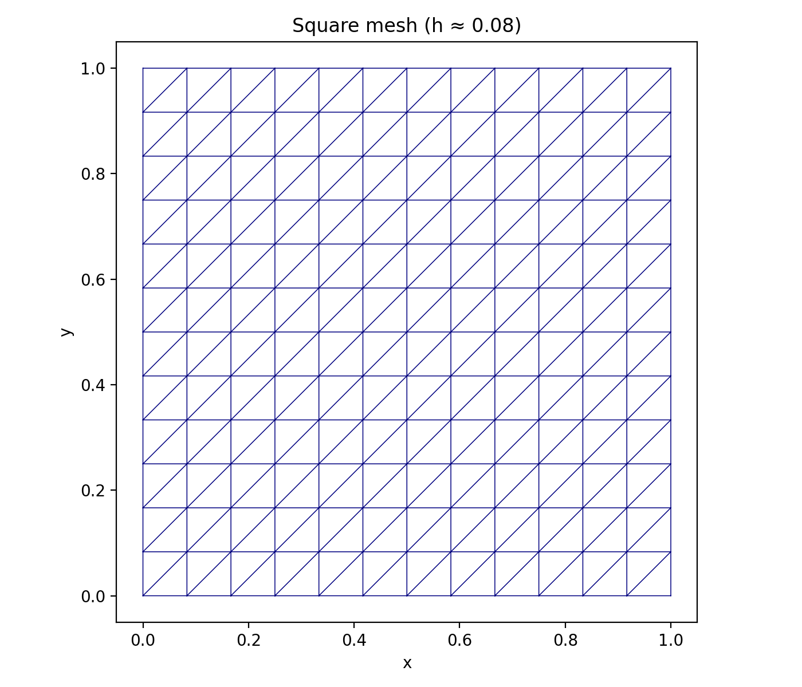

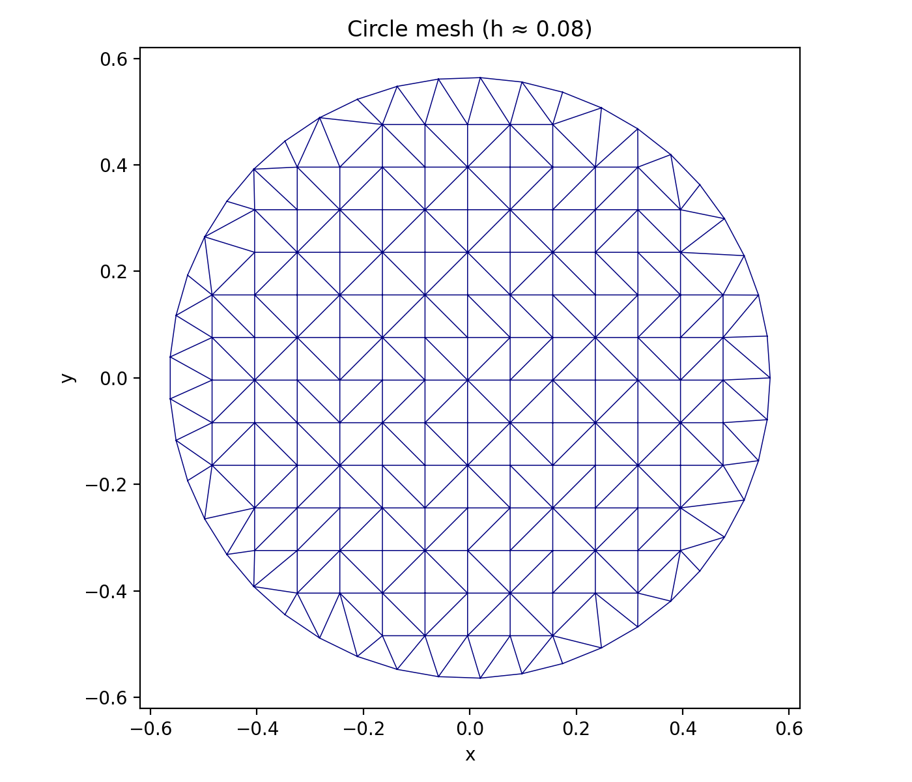

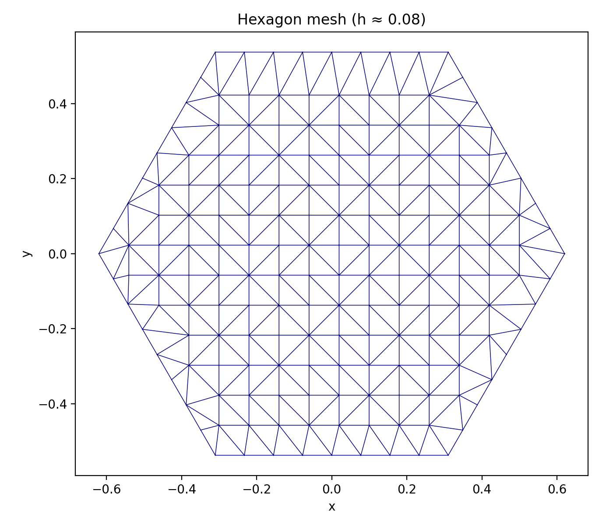

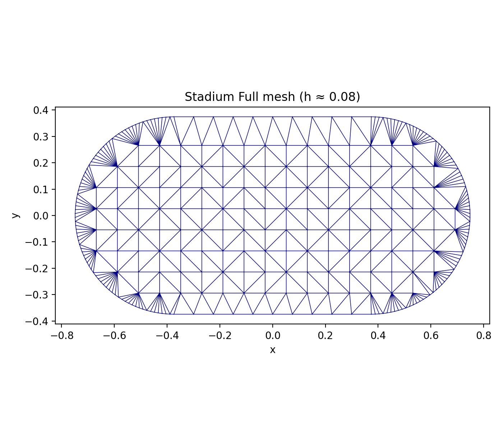

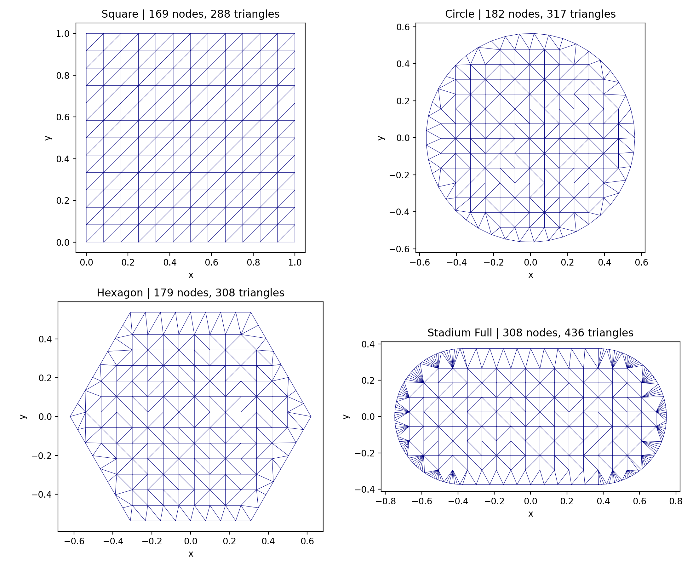

Mesh refinement is used to investigate numerical convergence and the sensitivity of the calculated energy eigenvalues to spatial discretization.

---

## Validation

The square and circle provide analytical benchmarks for validating the FEM implementation.

| Geometry | Exact $E_1$ | FEM $E_1$ | Error |
| --- | ---: | ---: | ---: |
| Square | 9.869604 | 9.879347 | 0.099% |
| Circle | 9.084207 | 9.089569 | 0.059% |

Mesh-refinement studies show convergence toward the analytical results and increasing stability of the numerical solutions.

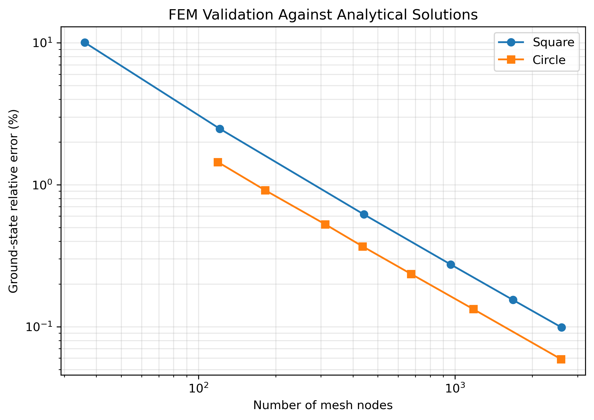

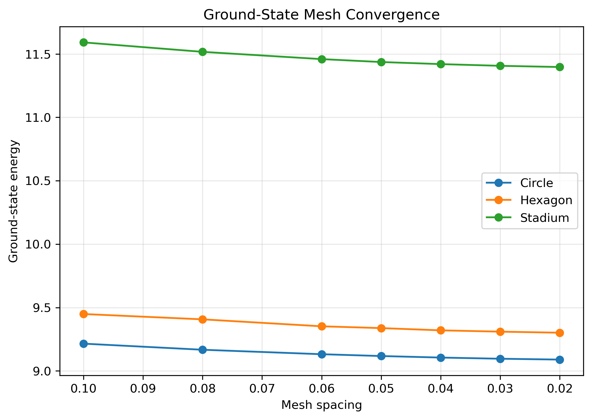

---

## Equal-Area Spectrum

The ground-state energies obtained in the primary geometry comparison are:

| Geometry | $E_1$ |
| --- | ---: |
| Circle | 9.089569 |
| Hexagon | 9.301499 |
| Square | 9.879347 |
| Stadium | 11.396646 |

The circle produces the lowest ground-state energy, consistent with the Faber-Krahn theorem for equal-area domains.

The excited-state spectra also display geometry-dependent degeneracy and symmetry structures.

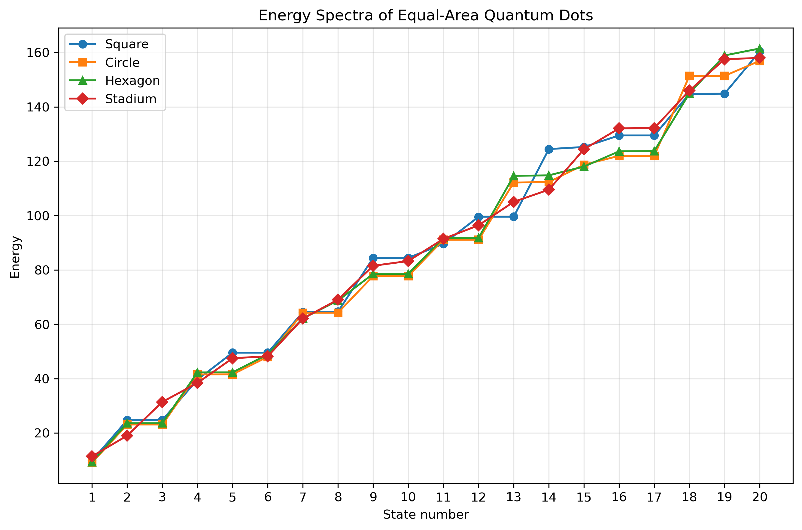

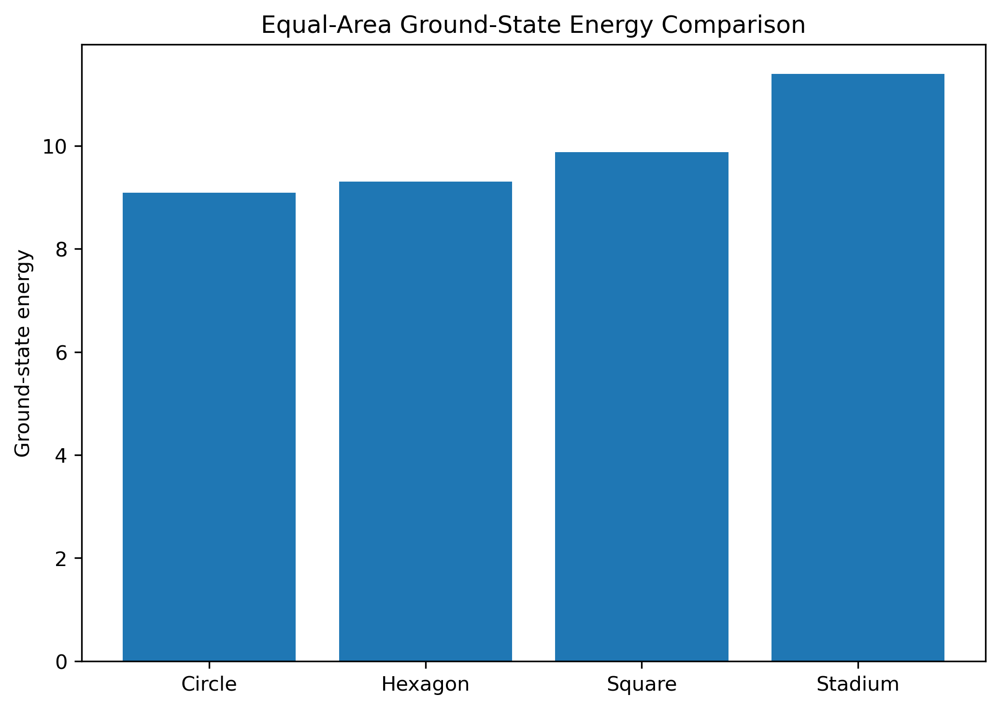

---

## Eigenfunctions

FEM eigenvectors are reconstructed on the full meshes to visualize the spatial wavefunctions and probability densities.

The resulting states show the characteristic symmetry structures of the square, circle, hexagon, and stadium geometries.

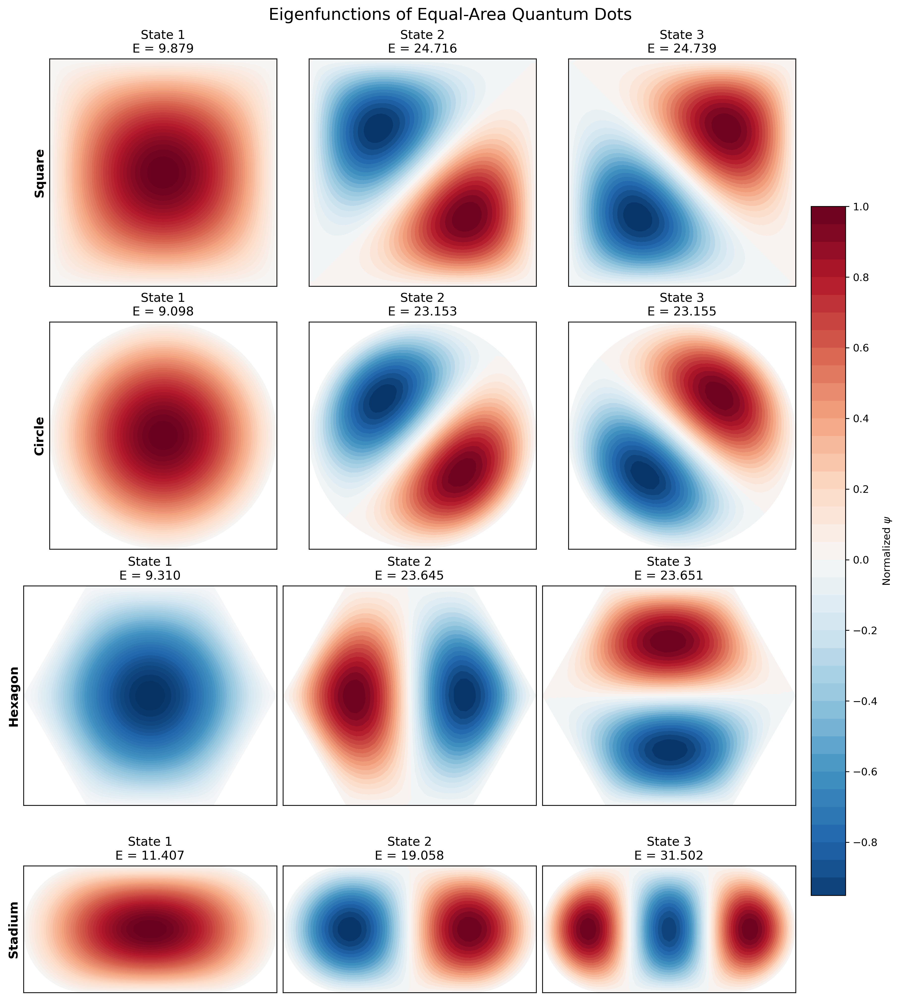

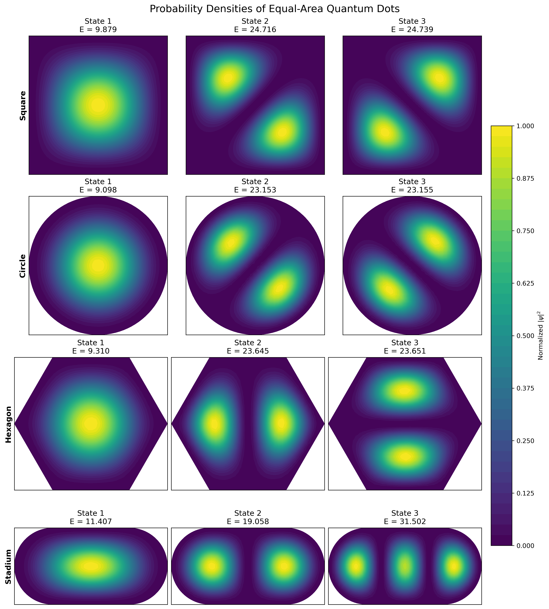

---

## Full-Stadium FEM Calculation

The Bunimovich stadium is solved directly on its complete two-dimensional domain using `stadium_solver.py`.

Unlike the symmetry-reduced approach, this calculation does not divide the geometry into quarters or reconstruct the eigenfunctions through reflection.

The full-stadium solver applies Dirichlet boundary conditions only along the physical outer boundary.

The coordinate axes remain interior lines of the domain.

The resulting eigenfunctions can therefore exhibit the stadium's natural reflection symmetries without imposing them explicitly.

### Full-Stadium Mesh Convergence

Two mesh resolutions were investigated:

| Mesh spacing | Nodes | Triangles | Ground-state energy |
| --- | ---: | ---: | ---: |
| $h=0.04$ | 818 | 1,398 | 11.41944971 |
| $h=0.02$ | 2,666 | 5,056 | 11.39634214 |

The relative change in the ground-state energy is calculated as

$$
\delta E_1 =
\frac{|E_1(0.04)-E_1(0.02)|}{E_1(0.02)}
\times100\%.
$$

This gives

$$
\delta E_1\approx0.203\%.
$$

The ground-state energy changes relatively little under refinement, while higher-energy states exhibit larger changes because their eigenfunctions have more rapid spatial oscillations.

The twentieth eigenvalue changes from

$$
E_{20}(0.04)=163.07832400
$$

to

$$
E_{20}(0.02)=157.99957549.
$$

This corresponds to a relative change of approximately 3.214%.

These results demonstrate numerical refinement behavior, although further refinement would be necessary to estimate the remaining error relative to the continuum eigenvalues.

---

## Stadium Reflection-Symmetry Sectors

The stadium is symmetric under reflection about both coordinate axes.

The eigenfunctions can therefore be classified according to their parity:

$$
\psi(-x,y)=p_x\psi(x,y),
$$

$$
\psi(x,-y)=p_y\psi(x,y),
$$

where

$$
p_x,p_y\in\{-1,+1\}.
$$

This produces four symmetry sectors:

$$
(+,+),\quad(+,-),\quad(-,+),\quad(-,-).
$$

For each symmetry axis:

- Even parity corresponds to a natural Neumann boundary condition.
- Odd parity corresponds to a Dirichlet boundary condition.

The physical outer boundary always satisfies the Dirichlet condition.

The script `stadium_sector_solver.py` calculates the eigenvalues independently within each symmetry sector.

The four spectra can then be merged and sorted to reconstruct the full-stadium energy spectrum.

### Quarter-Stadium Mesh Validation

At $h=0.02$, the quarter-stadium mesh contains:

- 735 nodes
- 1,313 triangular elements

The calculated mesh area is

$$
A_{\mathrm{mesh}}=0.2499927536,
$$

compared with the exact quarter-stadium area

$$
A_{\mathrm{exact}}=0.25.
$$

The relative area error is

$$
\frac{|A_{\mathrm{mesh}}-A_{\mathrm{exact}}|}
{A_{\mathrm{exact}}}
\approx2.898548\times10^{-5}.
$$

This indicates that the triangulated quarter-domain closely approximates the intended geometry.

---

## Full-Stadium vs. Symmetry-Reduced Comparison

To validate the symmetry-reduced calculation, the first 20 full-stadium eigenvalues were compared against the merged spectra of the four quarter-stadium symmetry sectors.

Both calculations used nominal mesh spacing $h=0.02$.

The relative difference for each eigenvalue is defined as

$$
\delta_n=
\frac{|E_n^{\mathrm{full}}-E_n^{\mathrm{sector}}|}
{E_n^{\mathrm{full}}}\times100\%.
$$

### Eigenvalue Comparison

| State | Sector | Full Stadium | Quarter Stadium |
| --- | --- | ---: | ---: |
| 1 | ++ | 11.39634214 | 11.39607338 |
| 2 | -+ | 19.02699668 | 19.02538129 |
| 3 | ++ | 31.41552975 | 31.41434951 |
| 4 | +- | 38.40488305 | 38.40434066 |
| 5 | -- | 47.49326366 | 47.49059516 |
| 6 | -+ | 48.21078773 | 48.20886404 |
| 7 | +- | 62.09415661 | 62.08595868 |
| 8 | ++ | 69.07369701 | 69.06992281 |
| 9 | -- | 81.50787091 | 81.49904063 |
| 10 | ++ | 83.27317632 | 83.27271842 |
| 11 | -+ | 91.41653974 | 91.40127373 |
| 12 | -+ | 96.41101923 | 96.41107863 |
| 13 | +- | 105.04641887 | 105.03288194 |
| 14 | ++ | 109.51252827 | 109.49569774 |
| 15 | ++ | 124.39235296 | 124.38095834 |
| 16 | -- | 132.08414197 | 132.05235297 |
| 17 | -+ | 132.15984899 | 132.15285441 |
| 18 | +- | 145.97973509 | 145.98021443 |
| 19 | -+ | 157.53401711 | 157.51317313 |
| 20 | -- | 157.99957549 | 157.99862342 |

All 20 eigenvalues agree within approximately 0.025%.

The largest relative difference occurs at state 16:

$$
\delta_{16}\approx0.0241\%.
$$

The agreement provides strong numerical evidence that the symmetry-reduced formulation reproduces the same physical eigenvalue problem as the direct full-domain calculation.

Small discrepancies are expected because the two methods use independently generated finite-element meshes.

The comparison measures agreement between the two numerical formulations rather than error relative to the exact continuum spectrum.

---

## Stadium Eigenfunction Comparison

The full-domain and symmetry-reduced formulations can also be compared through their eigenfunctions.

The script `stadium_eigenfunction_comparison.py` selects representative eigenfunctions from all four parity sectors:

| Full-stadium state | Parity |
| --- | --- |
| 1 | ++ |
| 2 | -+ |
| 4 | +- |
| 5 | -- |

The full-stadium eigenfunctions are calculated directly on the complete domain.

The quarter-stadium eigenfunctions are reconstructed using reflection symmetry for comparison purposes.

For odd parity, the reconstructed wavefunction changes sign across the corresponding symmetry axis.

For even parity, the wavefunction retains its sign under reflection.

Because eigenvectors are defined up to an arbitrary overall sign, their signs must be aligned before comparing their spatial distributions.

The comparison evaluates differences between the numerical eigenfunctions after appropriate interpolation and normalization.

This provides an additional validation of the spatial solutions beyond agreement between energy eigenvalues.

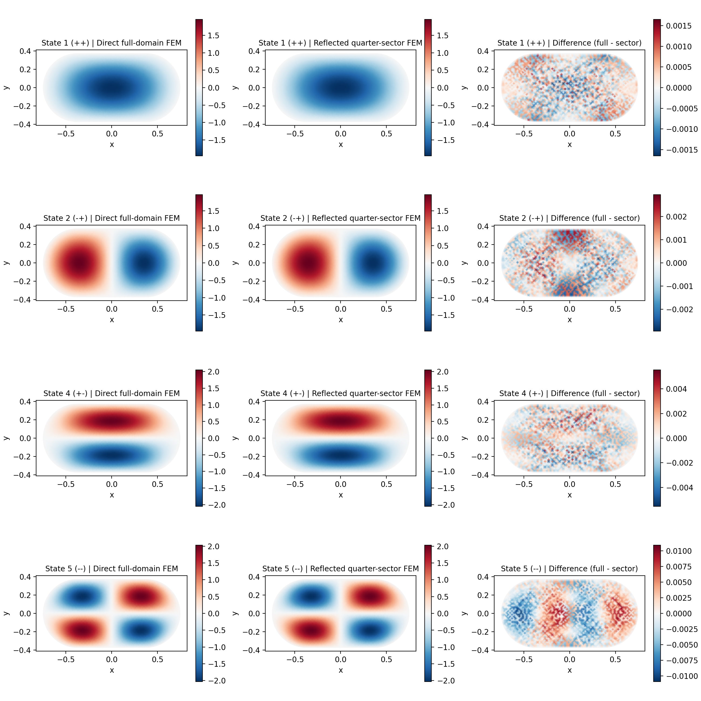

---

## Independent Basis Comparison

An independent rectangular sine-basis method is used as a numerical cross-check for the hexagon and stadium.

The geometry is represented using a finite external potential barrier and the Hamiltonian is diagonalized in a truncated sine basis.

Because this method uses both a finite barrier and a finite basis, it is not an exact representation of the infinite-wall FEM problem.

It is therefore used as an independent comparison rather than an exact benchmark.

Basis-size and barrier-height studies are included in `basis_convergence.py`.

---

## Stadium Quantum Chaos

The stadium billiard is also used to investigate spectral signatures of quantum chaos.

Because the stadium has reflection symmetry about both coordinate axes, the spectrum is separated into four parity sectors:

$$
(+,+),\quad(+,-),\quad(-,+),\quad(-,-).
$$

Adjacent-gap ratios are calculated independently within each symmetry sector before being combined.

For consecutive energy levels,

$$
s_n=E_{n+1}-E_n,
$$

the adjacent-gap ratio is

$$
r_n=
\frac{\min(s_n,s_{n+1})}
{\max(s_n,s_{n+1})}.
$$

At the finest investigated mesh spacing,

$$
h=0.01,
$$

the calculation gives

$$
\langle r\rangle=0.5374.
$$

For comparison,

$$
\langle r\rangle_{\mathrm{Poisson}}\approx0.3863,
$$

while GOE statistics give a mean adjacent-gap ratio near $0.53$.

The calculated stadium statistic is therefore consistent with the GOE-like level repulsion expected for a quantum-chaotic billiard.

Separating the symmetry sectors is important because mixing independent symmetry classes can obscure the level-repulsion statistics of individual sectors.

Mesh and level-count studies are included to test the robustness of this result.

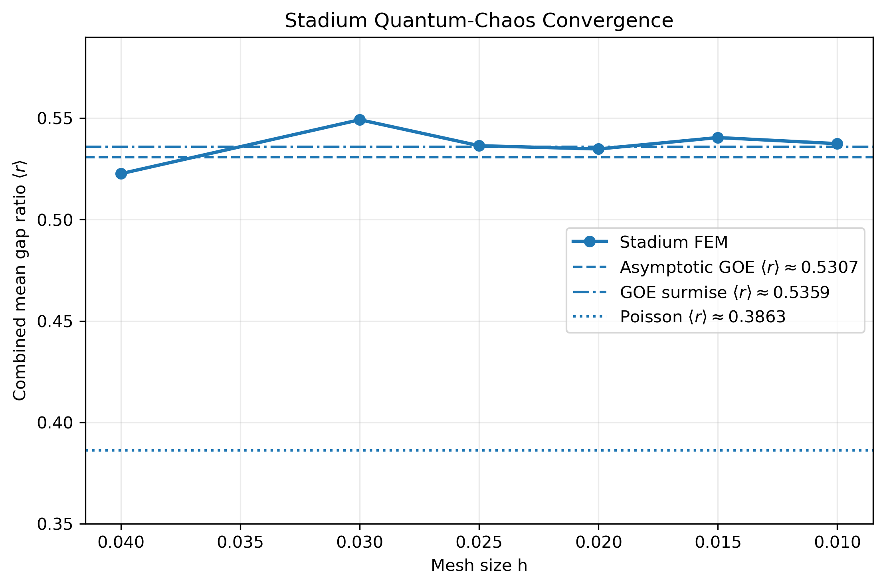

---

## Repository Structure

```text
Quantum-Dots/
│
├── src/
│   ├── FEM.py
│   │
│   ├── square_solver.py
│   ├── circle_mesh.py
│   ├── circle_solver.py
│   ├── hexagon_mesh.py
│   ├── hexagon_solver.py
│   ├── stadium_mesh.py
│   ├── stadium_solver.py
│   │
│   ├── convergence_study.py
│   ├── compare_geometries.py
│   ├── plot_eigenfunctions.py
│   ├── mesh_gallery.py
│   │
│   ├── box_basis.py
│   ├── circle_analytical.py
│   ├── hexagon_basis.py
│   ├── stadium_basis.py
│   ├── basis_convergence.py
│   ├── compare_methods.py
│   │
│   ├── stadium_sector_solver.py
│   ├── stadium_full_analysis.py
│   ├── stadium_eigenfunction_comparison.py
│   ├── stadium_chaos.py
│   └── chaos_convergence.py
│
├── results/
│   ├── data/
│   └── figures/
│
├── README.md
├── LICENSE
└── requirements.txt
```

---

## Running the Project

Install the required packages:

```bash
pip install -r requirements.txt
```

Run the main equal-area comparison:

```bash
python src/compare_geometries.py
```

Run the FEM convergence study:

```bash
python src/convergence_study.py
```

Generate the mesh figures:

```bash
python src/mesh_gallery.py
```

Generate the eigenfunction figures:

```bash
python src/plot_eigenfunctions.py
```

Run the full-stadium FEM solver:

```bash
python src/stadium_solver.py
```

Run the four stadium symmetry sectors:

```bash
python src/stadium_sector_solver.py
```

Generate the full-stadium eigenfunction comparison:

```bash
python src/stadium_eigenfunction_comparison.py --h 0.02
```

Run the independent FEM/basis comparison:

```bash
python src/compare_methods.py
```

Run the basis convergence study:

```bash
python src/basis_convergence.py
```

Run the stadium quantum-chaos analysis:

```bash
python src/stadium_chaos.py
```

Test the convergence of the chaos statistic:

```bash
python src/chaos_convergence.py
```

---

## Summary

The project demonstrates that FEM provides an accurate and flexible method for solving the two-dimensional Schrödinger equation across different confinement geometries.

The square and circle reproduce known analytical spectra with small numerical error, while the equal-area comparison demonstrates the influence of boundary geometry on quantum energy levels and eigenfunctions.

The full-stadium calculation independently solves the quantum billiard without quarter-domain symmetry reduction or mirroring.

Comparison with the four symmetry-reduced calculations shows agreement within approximately 0.025% for the first 20 eigenvalues at $h=0.02$.

This validates the consistency of the two FEM formulations and demonstrates how reflection symmetry can be used to reduce computational cost without changing the underlying continuum eigenvalue problem.

The same FEM framework is extended to stadium quantum-chaos studies, where symmetry-resolved spectral statistics produce an adjacent-gap ratio consistent with GOE-like level repulsion and the expected signatures of quantum chaos.

---

## Acknowledgments

This repository contains the computational work developed as part of my M.S. Physics research at the University of Massachusetts Dartmouth.
